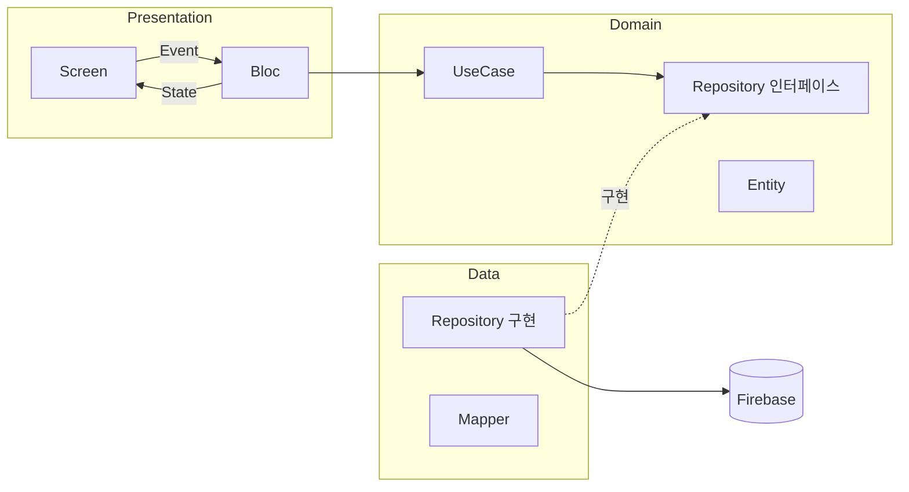

# 헬품타 Flutter

> 친구들과 그룹을 만들어 하루 한 번 운동을 인증하는 습관 공유 앱
> **네이티브 Android(Compose)로 출시한 [헬품타](https://github.com/JinsuPark01/WhatDoingApp)를 Flutter로 다시 구현한 프로젝트**

## 프로젝트 목적

같은 요구사항을 두 기술로 구현하고, **각 플랫폼의 현업 관례대로** 설계했을 때 무엇이 달라지는지 기록했습니다.

- 네이티브 앱을 **요구사항 명세**로 사용하고, 코드는 언어만 바꿔 옮기지 않고 Flutter다운 구조로 새로 작성
- 구현 중 발견한 네이티브의 버그·구조적 예외는 복사하지 않고 개선해서 구현
- 모든 차이와 판단 근거는 [비교 문서](docs/comparison.md)에 기록

## 기술 스택

| 분류 | 사용 기술 |
|---|---|
| 언어 / 프레임워크 | Dart 3.13, Flutter 3.47 |
| 아키텍처 | Clean Architecture (Presentation / Domain / Data) |
| 상태관리 | flutter_bloc, bloc_concurrency |
| 라우팅 | go_router |
| 백엔드 | Firebase Auth, Cloud Firestore, Cloud Storage |
| 주요 패키지 | google_sign_in, image_picker, flutter_image_compress, cached_network_image, gal, shared_preferences |

## 아키텍처



- 의존성은 Domain 방향으로만 향하며, Domain은 Flutter·Firebase를 모르는 순수 Dart
- Repository 인터페이스 + 생성자 주입 구조라 Firebase 없이 가짜 구현으로 테스트 가능
- 결과 처리는 Flutter 공식 아키텍처 가이드의 `Result` 패턴 사용

```
lib/
├── core/            # Result, 날짜 유틸
├── domain/          # entity, repository 인터페이스, usecase
├── data/            # repository 구현, mapper, Firebase·플랫폼 연동
├── presentation/    # 화면별 Event / State / Bloc / Screen
└── app/             # 라우터, 의존성 조립
```

## 주요 설계 결정

| 결정 | 이유 |
|---|---|
| **Bloc + status 기반 일회성 효과** | Bloc엔 SideEffect 채널이 없음. 네이티브 MVI 구조를 흉내 내는 대신 Bloc 현업 방식(단순 이동은 화면에서 직접, 서버 결과는 `status` 변화 + `BlocListener`)을 따름 |
| **화면 간 결과는 `pop(결과)` + `await push()`** | 네이티브 `savedStateHandle` 신호 + 수동 초기화 방식에서 겪었던 "신호 누락·초기화 타이밍" 문제가 구조적으로 발생하지 않음 |
| **비즈니스 규칙은 UseCase에서 보장** | "하루 한 번 작성", "당일만 수정"을 화면 버튼 상태에만 맡기지 않고 저장 직전에 재확인 |
| **오프라인 쓰기 사전 차단** | Firestore는 오프라인 쓰기를 임시 저장하고 서버 응답까지 대기 → 무한 로딩과 중복 생성 위험. 요청 전 연결 확인으로 즉시 실패 처리 |
| **이벤트 동시성 선언형 제어** | 날짜 연타는 `restartable`(이전 요청 결과 폐기), 삭제·탈퇴는 `droppable`(중복 요청 무시) |
| **플랫폼 객체를 Data 레이어에 격리** | 네이티브는 Google 로그인에 필요한 Activity가 ViewModel까지 전달됐지만, Flutter에선 토큰 획득을 Repository 내부로 옮겨 UI → Data 의존 제거 |

## 네이티브와 비교해 달라진 점 (요약)

| 항목 | Native (Compose) | Flutter |
|---|---|---|
| 화면 간 결과 전달 | `savedStateHandle` 신호 + 소비 처리 | `await push()` 반환값 |
| 재진입 시 중복 로딩 | `LaunchedEffect` 재실행 → 수동 가드 필요 | Bloc은 라우트당 한 번 생성 |
| 위젯 → 이미지 캡처 | `GraphicsLayer` → 기기마다 해상도 다름 | `RepaintBoundary` + `pixelRatio` → 1080×1920 고정 |
| 이미지 상태 표현 | `String?` + `startsWith("http")` 판별 | sealed class (없음 / 기존 / 신규) |
| 설정 변경 구독 | DataStore `Flow` 기본 제공 | 변경 알림이 없어 Repository에서 Stream 직접 구성 |
| UI 테스트 | 기본이 에뮬레이터 | 위젯 테스트가 PC에서 바로 실행 |

전체 비교와 근거는 [docs/comparison.md](docs/comparison.md)에 단계별로 정리되어 있습니다.

## 구현하며 발견해 개선한 것

네이티브 코드를 명세로 읽으며 찾은 문제를 Flutter에서는 개선해서 구현했습니다. (일부)

- 이미지 교체 시 기존 이미지를 먼저 지워, 문서 업데이트 실패 시 기록 사진이 깨지는 문제 → 새 이미지 업로드 → 문서 갱신 → 기존 이미지 삭제 순으로 변경
- 날짜를 빠르게 넘기면 늦게 도착한 이전 날짜 응답이 화면을 덮어쓰는 문제 → 이전 요청 결과 폐기
- 오프라인에서 재인증이 실패해도 "비밀번호를 확인해주세요"로 안내되는 문제 → 실패 원인 구분
- 홈에서 한 번 로딩에 실패하면 이후 성공해도 에러 화면이 유지되는 문제 → 성공 시 에러 상태 초기화

## 실행 방법

```bash
flutter pub get
flutter run
```

- Firebase 설정 파일(`firebase_options.dart`, `google-services.json`)이 포함되어 있어 별도 설정 없이 실행됩니다
- Google 로그인은 등록된 디버그 서명(SHA-1)에서만 동작합니다
- iOS는 빌드 검증까지만 진행했습니다 (실기기 미검증)
